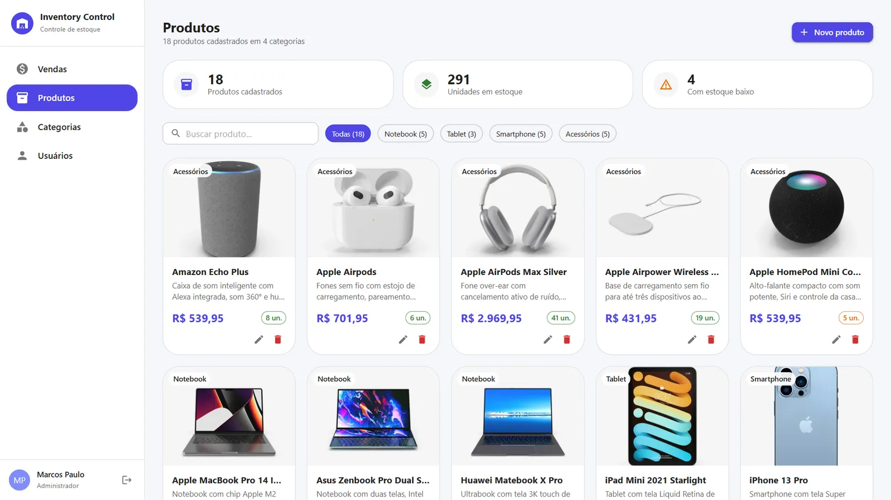
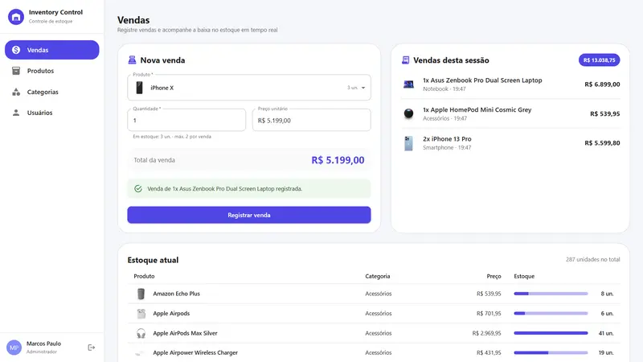
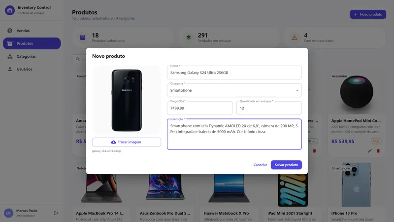
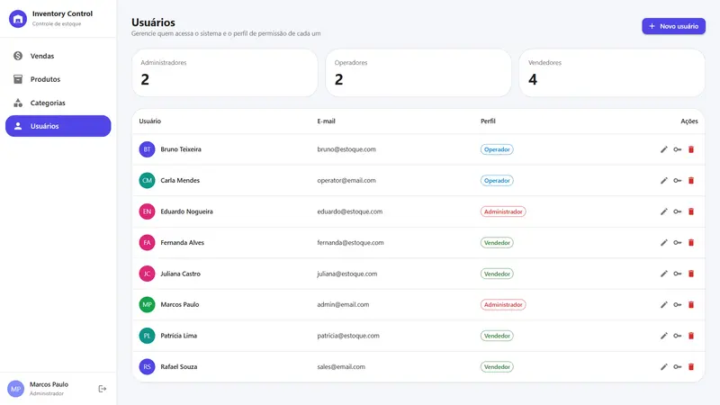

# Controle de Estoque e Vendas — Front-end em React

Front-end em React do sistema de controle de estoque, integrado à API em Node.js.

<p align="center">
  
</p>

---

## Sumário

- [Visão geral](#visão-geral)
- [Telas](#telas)
- [Stack e versões](#stack-e-versões)
- [Estrutura do projeto](#estrutura-do-projeto)
- [Primeiros passos](#primeiros-passos)
- [Configuração](#configuração)
- [Scripts](#scripts)
- [Projetos relacionados](#projetos-relacionados)
- [Autor](#autor)

---

## Visão geral

Interface para gerenciar produtos, categorias, vendas e usuários de uma loja, consumindo a [API de controle de estoque](https://github.com/marcospsdev/Stock-Control-API-in-Node.js). Tem login com JWT, cards de produto com imagem e indicadores de estoque, cadastro com upload de imagem, registro de vendas com baixa no estoque e gestão de usuários por perfil (Administrador, Operador e Vendedor).

Principais funcionalidades:

- Login com JWT e telas por perfil de usuário
- Produtos com imagem, categoria e indicador de estoque baixo
- Cadastro de produto com upload de imagem
- Vendas com baixa automática no estoque
- Gestão de usuários e redefinição de senha

Concluído em 08/2025.

---

## Telas

Todas as telas usam dados fictícios.

<table>
  <tr>
    <td width="50%"><br><sub>Tela de vendas com baixa no estoque</sub></td>
    <td width="50%"><br><sub>Cadastro de produto com upload de imagem</sub></td>
  </tr>
  <tr>
    <td width="50%"><br><sub>Usuários com perfis de permissão</sub></td>
  </tr>
</table>

---

## Stack e versões

| Categoria | Tecnologia | Versão |
| --- | --- | --- |
| Linguagem | TypeScript | 5.8 |
| UI | React | 19.1 |
| Build | Vite | 7.1 |
| Rotas | React Router | 7.8 |
| Estilo | Tailwind CSS | 4.1 |
| Componentes | Material UI | 7.3 |
| Ícones | Material Icons | 7.3 |
| Qualidade | ESLint + Prettier | 9.33 / 3.6 |

As versões exatas estão no `package.json`.

---

## Estrutura do projeto

```
src/
  assets/
    react.svg
  components/
    layout/
  config/
    apiConfig.ts
  lib/
    format.ts
  pages/
    categories/
    login/
    products/
    sales/
    users/
  services/
    authService.ts
    categoryService.ts
    fetchApi.ts
    productService.ts
    userService.ts
  App.css
  App.tsx
  index.css
  main.tsx
  vite-env.d.ts
```

---

## Primeiros passos

### Pré-requisitos

- Node.js 20.19 ou mais recente
- npm

### Instalação

```bash
git clone https://github.com/marcospsdev/Inventory-Control-in-React.git
cd Inventory-Control-in-React
npm install
npm run dev               # http://localhost:5173
```

---

## Configuração

A URL da API fica em `src/config/apiConfig.ts` (padrão: `http://localhost:3333/v1`). Suba a API antes de rodar o front.

---

## Scripts

| Comando | Descrição |
| --- | --- |
| `npm run dev` | Servidor de desenvolvimento (Vite) |
| `npm run build` | Typecheck e build de produção em `dist/` |
| `npm run lint` | Analisa o código com o ESLint |
| `npm run preview` | Serve o build de produção localmente |

---

## Projetos relacionados

- [Stock-Control-API-in-Node.js](https://github.com/marcospsdev/Stock-Control-API-in-Node.js): API REST em Node.js
- [Inventory-Control-in-React](https://github.com/marcospsdev/Inventory-Control-in-React): front-end em React
- [Inventory-Control-in-Angular](https://github.com/marcospsdev/Inventory-Control-in-Angular): front-end em Angular

---

## Autor

**Marcos Paulo** · Desenvolvedor Full-Stack

- LinkedIn: [in/marcospsdev](https://www.linkedin.com/in/marcospsdev)
- GitHub: [@marcospsdev](https://github.com/marcospsdev)
